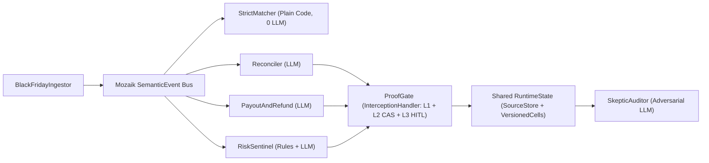

# LedgerProof

[](https://github.com/Gruya13/ledgerproof/actions/workflows/ci.yml)

**Concurrent, Evidence-First Black Friday Reconciliation & Controlled Payout System on Mozaik (`@mozaik-ai/core@6.0.0`)**

> **Compliance Notice:** LedgerProof uses **100% synthetic financial data** for demonstration only. Output is **not financial advice**.

---

## What It Does

LedgerProof unifies three Traditional Finance workflows from the hackathon brief on a reactive multi-agent event bus:
1. **Reconciliation & Exception Resolution** — deterministic `StrictMatcher` settles clean 1:1 invoices with `0` LLM tokens, while `Reconciler` handles split/partial payments and memo typos (`TX-2006 + TX-2007 → INV-1006`).
2. **Risk Investigation & Duplicate/BEC Guard** — `RiskSentinel` runs concurrently to lock duplicate invoices (`INV-1009`), BEC vendor IBAN changes (`REQ-3002`), currency mismatches, overpayment anomalies, and Black Friday velocity fraud alerts (`TX-2016`).
3. **Controlled SEPA `pain.001` Payout & Refund Routing** — `PayoutAndRefund` enforces EUR-only SEPA rails (`SEPA_REQUIRES_EUR`), respects spending limits (`$250` / `€250` auto-approve threshold), generates downloadable **ISO 20022 `pain.001.001.09` XML** drafts with SHA-256 digests (`GET /api/sepa/:invoiceId.xml`), and routes high-risk or over-limit transfers through human approval without pausing peer Mozaik loops.

Every financial conclusion and tool call is mechanically gated by **`ProofGate`** (`InterceptionHandler`):
- **L1 Source, Currency & Math Gate:** blocks uncited or invented amounts, raw integer `amountCents` mislabeled as USD/EUR, non-EUR SEPA payouts, and invalid IDs mid-loop (`inventedNumbersLeaked = 0`).
- **L2 CAS Write-Skew Gate:** `VersionedCell` optimistic concurrency prevents parallel agents from issuing a refund against an invoice concurrently locked for fraud.
- **L3 Controlled Payment HITL Gate:** suspends only the flagged payout loop for human decision while all other Mozaik loops continue concurrently.
- **Palimpsest `STALE` Invalidation:** late settlements (`TX-2017`) increment cell version and automatically invalidate dependent overdue chase drafts.

## Concurrent Mozaik Architecture



Each concurrent `runLoop(...)` receives a fresh isolated `ModelContext` and its own `ProofGateInterceptionHandler` instance so parallel loops never race on shared context mutation.

---

## Quick Start (Zero API Key Required)

```bash
npm install
npm run ui
```

Open **http://localhost:4317** in your browser and click **Start Interactive Stream**:
1. Watch the **Concurrent Mozaik Agent Swimlanes** execute in real time.
2. Notice **ProofGate L3 HITL** pauses only `REQ-3002` (`€640.00` BEC IBAN mismatch on `INV-1010`) while peer invoices converge concurrently — click **Reject (Lock HOLD_RISK)** (or **Approve Execution**).
3. Click **Inject Late Settlement (TX-2017)** to watch `INV-1007` close and its active overdue chase draft flip automatically to **`STALE`**.
4. Inspect **Blocked / Rejected Claims** (L1 hallucination `$319.99 / TX-9999` + L2 CAS write-skew catch on `INV-1011`), click any `[src:ID]` pill to verify its `SHA-256` source record, or click **Preview pain.001** / **Download XML** on any `SEPA_DRAFT_READY` row (`INV-1001`, `INV-1012`).

### Automated Proof, CLI Demo & Continuous Stream

```bash
npm run proof                               # Automated 12/12 ground-truth + concurrency invariants check
npm run demo -- --auto                      # Non-interactive CLI run + exports out/audit-trace.jsonl
npm run demo -- --stream --ticks 8 --auto   # Continuous Chaos Stream in CLI (periodic traps + HITL)
npm test                                    # Vitest unit + E2E + HTTP/SSE + Continuous Stream suites
npm run typecheck                           # TypeScript check for both backend and React UI
```

### Continuous Chaos Stream Mode (Web UI & CLI)

In the Web UI (`npm run ui`) or CLI (`--stream`), **ContinuousStreamGenerator** emits synthetic Black Friday invoices, payments, and SEPA requests (`INV-2001+`, `TX-5001+`, `REQ-6001+`) continuously with varied dynamic dollar amounts while periodically (or on-demand via **Inject Trap Now**) injecting 11 scenarios — both real traps and benign false-positive tests:
- **Real Traps:** `split_typo`, `partial_late_stale`, `duplicate_invoice`, `orphan_wire`, `bec_iban_change` (non-blocking HITL pause), `write_skew_race` (L1 + L2 CAS interlock), `currency_mismatch`, and `overpayment_anomaly`.
- **Benign / False-Positive Tests:** `legit_high_value_sepa` (including spaced IBAN normalization), `legit_high_value_refund` (`0` risk flags — safe to approve), and `false_positive_near_duplicate` (same vendor & amount, different PO).
- In **Live LLM Mode**, a built-in `maxLlmCalls` budget guard (`default: 40`) auto-pauses the stream before runaway API usage while deterministic `StrictMatcher` ticks still cost `0` LLM calls.

---

## Live LLM Mode (Multi-Provider)

Copy `.env.example` to `.env` and set **any one** provider key (`DEEPSEEK_API_KEY`, `OPENAI_API_KEY`, `ANTHROPIC_API_KEY`, or `GEMINI_API_KEY`), then run either:

```bash
npm start   # CLI live run
npm run ui  # Toggle "Live" mode in the Web UI header
```

---

## Verified Benchmark & Live Stress-Test Results

| Run | Mode / Seed | Scale | Concurrency & Loops | 0-Token Strict Matches | ProofGate Catches & Invariants |
|---|---|---|---|---|---|
| `npm test` | `MockInferenceRunner` + HTTP/SSE + Unit | `8` suites / `19` tests | Full concurrent E2E & stream | Deterministic pass | `inventedNumbersLeaked = 0`, ISO 20022 `pain.001` XML verified |
| `npm run proof` | `MockInferenceRunner` (fixed pack) | `12/12` invoices | `18` peak concurrent, `22/22` finished | `10` | `1` CAS conflict stopped, `1` L1 blocked, `1` `STALE`, `1` HITL, `0` leaked |
| `npm start -- --stream --ticks 80` | Live `deepseek-chat`, seed `2811646950` | `80` ticks (`26` traps), `83/83` invoices closed | `12` peak concurrent, `99/99` finished | `74` | Live L1 catch `REJ-2` (`$28,865.00` vs `$288.65` on `TX-5013`), `10` HITL, `2` `STALE`, `0` leaked |
| `npm start -- --stream --ticks 10` | Live `deepseek-chat`, seed `916840450` | `10` ticks (`3` traps), `9/9` invoices closed | `9` peak concurrent, `14/14` finished | `8` | `1` live L2 CAS write-skew stopped (`INV-2003`), `3` EUR `pain.001` drafts, `0` false L1 blocks, `0` leaked |
