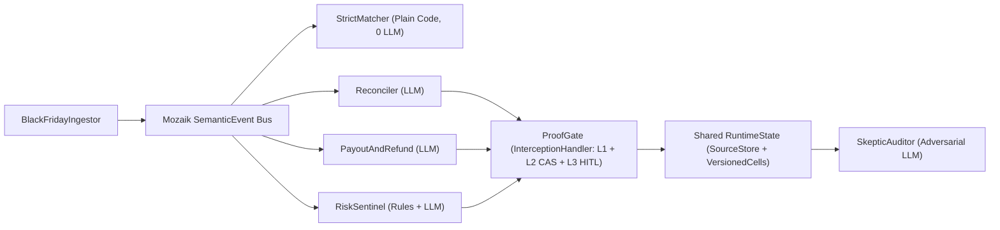

# LedgerProof

**Concurrent, Evidence-First Black Friday Reconciliation & Controlled Payout System on Mozaik (`@mozaik-ai/core@6.0.0`)**

> **Disclaimer:** LedgerProof uses **100% synthetic financial data** for demonstration only. Output is **not financial advice**.

---

## What It Does

LedgerProof unifies three core Traditional Finance workflows on a reactive multi-agent event bus:
1. **Reconciliation & Exception Resolution** — deterministic `StrictMatcher` settles clean 1:1 invoices with `0` LLM tokens, while `Reconciler` handles split/partial payments and memo typos.
2. **Risk Investigation & Duplicate/BEC Guard** — `RiskSentinel` runs concurrently to lock duplicate invoices, BEC vendor IBAN changes, and Black Friday velocity fraud alerts.
3. **Controlled SEPA Payout & Refund Routing** — `PayoutAndRefund` respects spending limits (`$250` auto-approve threshold) and routes high-risk/high-value transfers through human approval without pausing peer agents.

Every financial conclusion and tool call is mechanically gated by **`ProofGate`** (`InterceptionHandler`):
- **L1 Source & Math Gate:** blocks uncited or invented amounts and invalid IDs mid-loop (`inventedNumbersLeaked = 0`).
- **L2 CAS Write-Skew Gate:** `VersionedCell` optimistic concurrency prevents parallel agents from issuing a refund against an invoice concurrently locked for fraud.
- **L3 Controlled Payment HITL Gate:** suspends only the flagged payout loop for human decision while all other Mozaik loops keep running.
- **Palimpsest `STALE` Invalidation:** late settlements automatically increment cell version and invalidate dependent overdue chase drafts.

## Concurrent Mozaik Architecture



Each concurrent `runLoop(...)` receives a fresh isolated `ModelContext` and its own `ProofGateInterceptionHandler` instance.

## Quick Start (Zero API Key Required)

```bash
npm install
npm run proof
npm run demo -- --auto
npm test
npm run typecheck
```

### Live DeepSeek Mode (Optional)

Copy `.env.example` to `.env`, set `DEEPSEEK_API_KEY`, and run:

```bash
npm start
```
