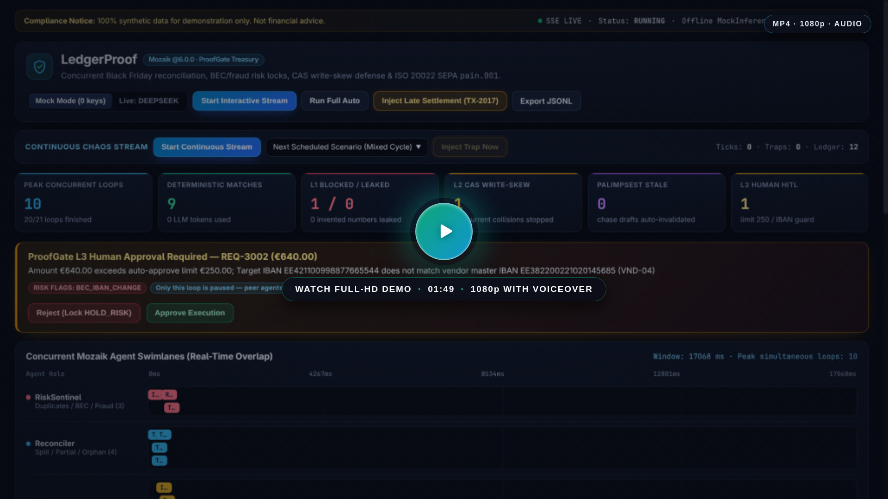
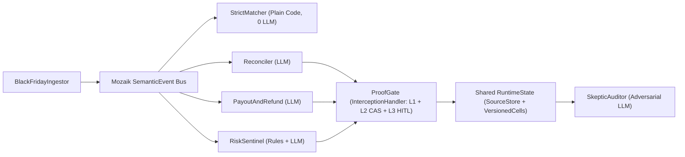

# LedgerProof

[](https://ledgerproof.ig-systems.rs)
[](https://github.com/Gruya13/ledgerproof/actions/workflows/ci.yml)


[](LICENSE)

> **Live Interactive Demo (Zero API Key Required):** **https://ledgerproof.ig-systems.rs**

**LedgerProof reconciles high-volume Black Friday payments across concurrent Mozaik agents (`@mozaik-ai/core@6.0.0`) — settling clean invoices deterministically with zero LLM tokens while mechanically blocking hallucinated numbers, write-skew refunds, and spoofed BEC IBAN payouts mid-loop.**

> **Compliance Notice:** LedgerProof uses **100% synthetic financial data** for demonstration only. Output is **not financial advice**.

[](https://github.com/Gruya13/ledgerproof/releases/download/demo-v1/ledgerproof-demo-final.mp4)
*▶ **[Watch Full-HD Demo Video (`1080p`, 1:49, English Voiceover)](https://github.com/Gruya13/ledgerproof/releases/download/demo-v1/ledgerproof-demo-final.mp4)** · [English Subtitles (`.srt`)](https://github.com/Gruya13/ledgerproof/releases/download/demo-v1/subtitles-en.srt) — Obsidian Treasury UI, concurrent Mozaik swimlanes, ProofGate L1/L2/L3 catches, Continuous Chaos Stream, CLI proof, and 10×60 live DeepSeek sweep.*

---

## What It Does

LedgerProof unifies three Traditional Finance workflows from the hackathon brief on a reactive multi-agent event bus:
1. **Reconciliation & Exception Resolution** — deterministic `StrictMatcher` settles clean 1:1 invoices with `0` LLM tokens, while `Reconciler` handles split/partial payments and memo typos (`TX-2006 + TX-2007 → INV-1006`).
2. **Risk Investigation & Duplicate/BEC Guard** — `RiskSentinel` runs concurrently to lock duplicate invoices (`INV-1009`), BEC vendor IBAN changes (`REQ-3002`), currency mismatches, overpayment anomalies, and Black Friday velocity fraud alerts (`TX-2016`).
3. **Controlled SEPA & Refund Routing (plus Optional `pain.001` Draft Export)** — `PayoutAndRefund` enforces EUR-only SEPA rails (`SEPA_REQUIRES_EUR`) and ISO 13616 mod-97 IBAN checks under a `25,000` minor-unit auto-approve limit (`€250` EUR / `$250` USD, no FX conversion), routes high-risk/over-limit payouts through non-blocking human approval, and exports downloadable **ISO 20022 `pain.001.001.09` XML** synthetic demo drafts (`<DbtrAgt>` `NOTPROVIDED`, 64-char SHA-256 via `GET /api/sepa/:invoiceId.xml` — not bank/XSD validated).

Every financial conclusion and tool call is mechanically gated by **`ProofGate`** (`InterceptionHandler`):
- **L1 Source, Currency & Math Gate:** blocks uncited or invented amounts, raw integer `amountCents` mislabeled as USD/EUR, non-EUR SEPA payouts, and invalid IDs mid-loop (`inventedNumbersLeaked = 0`).
- **L2 CAS Write-Skew Gate:** `VersionedCell` optimistic concurrency prevents parallel agents from issuing a refund against an invoice concurrently locked for fraud.
- **L3 Controlled Payment HITL Gate:** suspends only the flagged payout loop for human decision while all other Mozaik loops continue concurrently.
- **Palimpsest `STALE` Invalidation:** late settlements (`TX-2017`) increment cell version and automatically invalidate dependent overdue chase drafts.

## Concurrent Mozaik Architecture



Each concurrent `runLoop(...)` receives a fresh isolated `ModelContext` and its own `ProofGateInterceptionHandler` instance so parallel loops never race on shared context mutation.

---

## 60-Second Judge Walkthrough (Zero API Key Required)

Try the hosted deployment directly at **https://ledgerproof.ig-systems.rs**, or run locally:

```bash
npm install
npm run ui
```

Open **http://localhost:4317** (or **https://ledgerproof.ig-systems.rs**) in your browser and click **Start Interactive Stream**:
1. **The "Wow" Moment — Non-Blocking BEC HITL:** Watch the **Concurrent Mozaik Agent Swimlanes** run in parallel. `ProofGate` pauses **only** `REQ-3002` (`€640.00` spoofed vendor IBAN on `INV-1010`) for human review while all other invoices converge concurrently — click **Reject (Lock HOLD_RISK)**.
2. **Causal `STALE` Invalidation:** Click **Inject Late Settlement (TX-2017)** to watch `INV-1007` close and its active overdue chase draft flip automatically to **`STALE`**.
3. **Evidence & Catches:** Open **Blocked / Rejected Claims** (L1 hallucination `$319.99 / TX-9999` + L2 CAS write-skew catch on `INV-1011`), click any `[src:ID]` pill to verify its `SHA-256` source record, or optionally **Preview pain.001** on `SEPA_DRAFT_READY` rows (`INV-1001`, `INV-1012`).

### Docker / Self-Hosted Live Demo

```bash
docker compose up -d --build
```

- Runs on `node:22-slim` (works natively on both AMD64 and ARM64/Oracle Ampere) in **zero-key `MockInferenceRunner` mode** (`HOST=0.0.0.0`, `PORT=4317`) so public visitors cannot consume personal API credits.
- Each browser tab gets an isolated backend `SessionController` (`sessionStorage` ID passed on `/api/*` + 15-minute idle TTL cleanup), so concurrent judges do not overwrite each other's runs.
- `/api/events` sets `X-Accel-Buffering: no` with a 25s SSE heartbeat for clean streaming behind **Caddy** (`reverse_proxy localhost:4317`) or **Nginx** (`proxy_buffering off; proxy_http_version 1.1;`).

### Automated Proof, CLI Demo & Continuous Stream

```bash
npm run proof                               # Automated 12/12 ground-truth + concurrency invariants check
npm run demo -- --auto                      # Non-interactive CLI run + exports out/audit-trace.jsonl
npm run demo -- --stream --ticks 8 --auto   # Continuous Chaos Stream in CLI (periodic traps + HITL)
npm test                                    # Vitest unit + E2E + HTTP/SSE + Continuous Stream suites
npm run typecheck                           # TypeScript check for both backend and React UI
```

### Continuous Chaos Stream Mode (Web UI & CLI)

In the Web UI (`npm run ui`) or CLI (`--stream`), **ContinuousStreamGenerator** emits synthetic Black Friday invoices, payments, and payout requests (`INV-2001+`, `TX-5001+`, `REQ-6001+`) continuously with varied multi-currency amounts (**EUR** for SEPA payouts, **USD** for card/wire/refund flows) while periodically (or on-demand via **Inject Trap Now**) injecting 11 scenarios — both real traps and benign false-positive tests:
- **Real Traps:** `split_typo`, `partial_late_stale`, `duplicate_invoice`, `orphan_wire`, `bec_iban_change` (non-blocking HITL pause), `write_skew_race` (L1 + L2 CAS interlock), `currency_mismatch`, and `overpayment_anomaly`.
- **Benign / False-Positive Tests:** `legit_high_value_sepa` (including spaced IBAN normalization), `legit_high_value_refund` (`0` risk flags — safe to approve), and `false_positive_near_duplicate` (same vendor & amount, different PO).
- In **Live LLM Mode**, a built-in `maxLlmCalls` budget guard (`default: 40`) auto-pauses the stream before runaway API usage while deterministic `StrictMatcher` ticks still cost `0` LLM calls.

---

## Live LLM Mode (Multi-Provider)

Copy `.env.example` to `.env` and set **any one** provider key (`DEEPSEEK_API_KEY`, `OPENAI_API_KEY`, `ANTHROPIC_API_KEY`, or `GEMINI_API_KEY`), then run either:

```bash
npm start   # CLI live run
npm run ui  # Toggle "Live" mode in the Web UI header
```

---

## Limitations & What `ProofGate` Does Not Catch

- **Synthetic test suites vs. open-ended production drift:** `MockInferenceRunner` runs (`12/12` ground-truth, `npm test`) are repeatable deterministic regression proofs against self-authored test scenarios. Live LLM stress runs (`deepseek-chat`) exercise unscripted model behavior (e.g., catching an unscripted `$28,865.00` vs `$288.65` scale error on `TX-5013` in `REJ-2`).
- **Formal grounding vs. semantic business judgment:** `ProofGate` guarantees source existence, arithmetic consistency, currency/IBAN/vendor bindings, and CAS version freshness. A formally cited claim that misinterprets an unambiguous memo still requires **`SkepticAuditor`** adversarial review and **`L3 HITL`** escalation.
- **No live FX conversion & synthetic XML drafts:** Cross-currency transfers are flagged (`CURRENCY_MISMATCH`) rather than converted using live FX rates; auto-approve thresholds (`25,000` minor units: `€250` EUR / `$250` USD) are compared per currency; and `pain.001.001.09` XML outputs use synthetic `<DbtrAgt>` (`NOTPROVIDED`) and are not externally XSD-validated or bank-submitted.

---

## Verified Benchmark & Live Stress-Test Results

Full per-run tables, per-seed metrics, scenario distributions, and engineering notes are documented in **[docs/BENCHMARKS.md](docs/BENCHMARKS.md)**.

| Run | Mode / Seed | Scale | Concurrency & Loops | 0-Token Strict Matches | ProofGate Catches & Invariants |
|---|---|---|---|---|---|
| `npm test` | `MockInferenceRunner` + HTTP/SSE + Unit | `9` suites / `27` tests | Full concurrent E2E & stream | Deterministic pass | `inventedNumbersLeaked = 0`, session isolation, L1 IBAN/vendor/kind/citation binding, IBAN mod-97, immutable `SourceStore`, post-HITL staleness, refund balance, `<DbtrAgt>` XML |
| `npm run proof` | `MockInferenceRunner` (fixed pack) | `12/12` invoices | `18` peak concurrent, `22/22` finished | `10` | `1` CAS conflict stopped, `1` L1 blocked, `1` `STALE`, `1` HITL, `0` leaked |
| `npm start` (`3×` runs, `0f1046d`) | Live `deepseek-chat` (fixed pack) | `36/36` GT invoices (`3×12`) | `21` max peak, `66/66` finished | Deterministic path + `1` CAS each | `3/3` CAS stopped (`INV-1011`), `3/3` `STALE` (`INV-1007`), `3/3` BEC HITL rejected (`REQ-3002`), `0` leaked |
| `npm start -- --stream --ticks 80` | Live `deepseek-chat`, seed `2811646950` | `80` ticks (`26` traps), `83/83` invoices closed | `12` peak concurrent, `99/99` finished | `74` | Live L1 catch `REJ-2` (`$28,865.00` vs `$288.65` on `TX-5013`), `10` HITL, `2` `STALE`, `0` leaked |
| `10×60` Chaos Sweep (`0f1046d`) | Live `deepseek-chat`, `10` seeds (`10×60`) | `600` ticks (`200` scenarios), `614` invoices | `16` max peak, `745/745` finished | `536` | `59` L1 blocked (`0` leaked), `3` L2 CAS stopped, `135` SEPA `pain.001` XML, `71` HITL, `14` `STALE` (`10/10` runs OK) |
