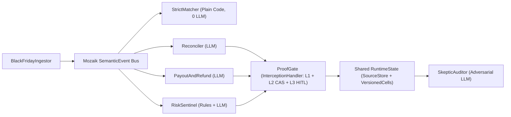

# LedgerProof

**Concurrent, Evidence-First Black Friday Reconciliation & Controlled Payout System on Mozaik (`@mozaik-ai/core@6.0.0`)**

> **Compliance Notice:** LedgerProof uses **100% synthetic financial data** for demonstration only. Output is **not financial advice**.

---

## What It Does

LedgerProof unifies three Traditional Finance workflows from the hackathon brief on a reactive multi-agent event bus:
1. **Reconciliation & Exception Resolution** — deterministic `StrictMatcher` settles clean 1:1 invoices with `0` LLM tokens, while `Reconciler` handles split/partial payments and memo typos (`TX-2006 + TX-2007 → INV-1006`).
2. **Risk Investigation & Duplicate/BEC Guard** — `RiskSentinel` runs concurrently to lock duplicate invoices (`INV-1009`), BEC vendor IBAN changes (`REQ-3002`), and Black Friday velocity fraud alerts (`TX-2016`).
3. **Controlled SEPA Payout & Refund Routing** — `PayoutAndRefund` respects spending limits (`$250` auto-approve threshold) and routes high-risk/high-value transfers through human approval without pausing peer Mozaik loops.

Every financial conclusion and tool call is mechanically gated by **`ProofGate`** (`InterceptionHandler`):
- **L1 Source & Math Gate:** blocks uncited or invented amounts and invalid IDs mid-loop (`inventedNumbersLeaked = 0`).
- **L2 CAS Write-Skew Gate:** `VersionedCell` optimistic concurrency prevents parallel agents from issuing a refund against an invoice concurrently locked for fraud.
- **L3 Controlled Payment HITL Gate:** suspends only the flagged payout loop for human decision while all other Mozaik loops continue concurrently.
- **Palimpsest `STALE` Invalidation:** late settlements (`TX-2017`) increment cell version and automatically invalidate dependent overdue chase drafts.

## Concurrent Mozaik Architecture



Each concurrent `runLoop(...)` receives a fresh isolated `ModelContext` and its own `ProofGateInterceptionHandler` instance so parallel loops never race on shared context mutation.

---

## Quick Start (Zero API Key Required)

```bash
npm install
npm run ui
```

Open **http://localhost:4317** in your browser and click **Start Interactive Stream**:
1. Watch the **Concurrent Mozaik Agent Swimlanes** execute in real time.
2. Notice **ProofGate L3 HITL** pauses only `REQ-3002` (`$640.00` BEC IBAN mismatch on `INV-1010`) while peer invoices converge concurrently — click **Reject Payout** (or **Approve Payout**).
3. Click **Inject Late Settlement (TX-2017)** to watch `INV-1007` close and its active overdue chase draft flip automatically to **`STALE`**.
4. Inspect **Blocked / Rejected Claims** (L1 hallucination `$319.99 / TX-9999` + L2 CAS write-skew catch on `INV-1011`) and click any `[src:ID]` pill to verify its `SHA-256` source record.

### Automated Proof, CLI Demo & Continuous Stream

```bash
npm run proof                               # Automated 12/12 ground-truth + concurrency invariants check
npm run demo -- --auto                      # Non-interactive CLI run + exports out/audit-trace.jsonl
npm run demo -- --stream --ticks 8 --auto   # Continuous Chaos Stream in CLI (periodic traps + HITL)
npm test                                    # Vitest unit + E2E + HTTP/SSE + Continuous Stream suites
npm run typecheck                           # TypeScript check for both backend and React UI
```

### Continuous Chaos Stream Mode (Web UI & CLI)

In the Web UI (`npm run ui`) or CLI (`--stream`), **ContinuousStreamGenerator** emits synthetic Black Friday invoices, payments, and SEPA requests (`INV-2001+`, `TX-5001+`, `REQ-6001+`) continuously while periodically (or on-demand via **Inject Trap Now**) injecting 6 intentional anomalies:
- `split_typo`, `partial_late_stale`, `duplicate_invoice`, `orphan_wire`, `bec_iban_change` (non-blocking HITL pause), and `write_skew_race` (L1 + L2 CAS interlock).
- In **Live LLM Mode**, a built-in `maxLlmCalls` budget guard (`default: 40`) auto-pauses the stream before runaway API usage while deterministic `StrictMatcher` ticks still cost `0` LLM calls.

---

## Live LLM Mode (Multi-Provider)

Copy `.env.example` to `.env` and set **any one** provider key (`DEEPSEEK_API_KEY`, `OPENAI_API_KEY`, `ANTHROPIC_API_KEY`, or `GEMINI_API_KEY`), then run either:

```bash
npm start   # CLI live run
npm run ui  # Toggle "Live" mode in the Web UI header
```
